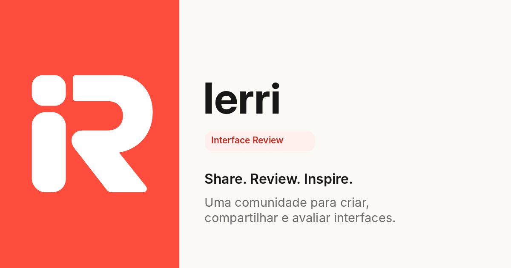

  

  <a href="https://github.com/Ierri/front-end">Frontend</a>
  &nbsp;·&nbsp;
  <a href="https://github.com/Ierri/back-end">Backend</a>

## Sobre o projeto

O **Ierri** (Interface Review) é um projeto acadêmico desenvolvido para uma disciplina de bancos de dados NoSQL da faculdade. O uso de **MongoDB** é um dos requisitos do trabalho.

A aplicação proposta é uma rede social voltada ao compartilhamento e à avaliação de interfaces digitais. Designers, desenvolvedores e outros criadores poderão apresentar seus projetos, consultar trabalhos de outros usuários e compartilhar feedbacks.

O projeto está em desenvolvimento. Seu escopo contempla publicações com imagens e vídeos, perfis públicos, comentários e votos. A navegação pelos conteúdos será pública, enquanto ações como publicar, comentar e votar exigirão autenticação.

## Contexto acadêmico

O trabalho aplica os conceitos estudados na disciplina à construção de uma aplicação web. A modelagem dos dados parte das necessidades da plataforma e utiliza coleções e documentos no MongoDB para representar usuários, publicações e suas interações.

Além da modelagem, o desenvolvimento envolve a implementação da API, a validação dos dados, a autenticação de usuários e a integração com o frontend. As funcionalidades são implementadas de forma incremental, acompanhando a evolução do modelo de dados.

## Repositórios

| Repositório | Responsabilidade | Tecnologias |
| --- | --- | --- |
| [front-end](https://github.com/Ierri/front-end) | Interface da aplicação e interação com os usuários. | Next.js, React, Tailwind CSS e shadcn/ui. |
| [back-end](https://github.com/Ierri/back-end) | API, autenticação e acesso ao banco de dados. | NestJS, MongoDB, Mongoose, JWT e Zod. |

Os dois projetos utilizam TypeScript e Bun. A API utiliza bcrypt para armazenar hashes de senha e JWT para autenticação das requisições.
